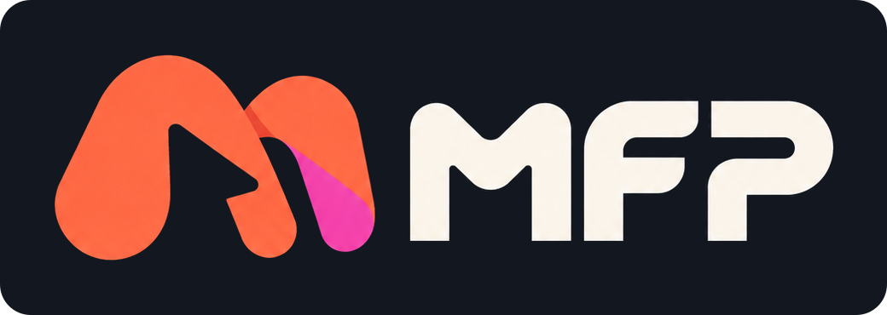

**Русский** · [English](README.md)

# MFP — Make · Frame · Prototype

**Бесплатный редактор интерфейсов для одного человека, команды и целой компании.**
Макеты, прототипы, анимация, режим разработчика и совместная работа — в браузере или в приложении
для компьютера, с интернетом или полностью без него.

Интерфейс — на русском и английском: язык выбирается при установке и меняется в приложении
(Настройки → «Язык / Language»).

MFP бесплатен для всех — для людей, студентов, фрилансеров и компаний любого размера. Без подписок,
без ограничений по функциям, без рекламы. Код открыт ([GNU AGPL-3.0](LICENSE)). Проект живёт на
пожертвования: если MFP вам полезен, поддержите его — [как помочь проекту](#поддержать-проект).

---

## Что умеет MFP

### Дизайн
- Фреймы, фигуры, векторные сети и перо, булевы операции, конструктор фигур, переменная толщина
  обводки, текст по контуру.
- Auto layout — строки, столбцы, перенос и сетка; constraints, сетки макета, направляющие.
- Компоненты, варианты и свойства, библиотеки команды с выборочным обновлением.
- Переменные с режимами (например, светлая и тёмная темы), стили цвета, текста, эффектов.
- Текст с OpenType, автоподбором размера, стилями; шрифты компьютера и 21 шрифт с кириллицей в
  комплекте — работают без интернета.
- Эффекты: тени, размытие (в том числе прогрессивное), шум, текстура, стекло, заливки шейдерами.
- Картинки с коррекцией и обрезкой, видео в заливке, анимации Lottie, 3D-модели (glTF / GLB).

### Прототипы и анимация
- Связи между экранами, оверлеи, прокрутка, переменные и условия в прототипе.
- Таймлайн анимации: ключевые кадры, кривые, повтор, обрезка контура.
- Показ прототипа в рамках устройств, ссылки на просмотр для коллег и заказчиков.

### Для разработчиков
- Режим разработчика: размеры, отступы, код CSS, Tailwind, SwiftUI, UIKit, Jetpack Compose,
  Android XML; экспорт ассетов.
- Экспорт PNG, JPG, WebP, AVIF, SVG и PDF (в том числе CMYK для печати).
- REST API, вебхуки, интеграции со Slack, Telegram и Jira.
- Подключение ИИ-агентов по MCP (Claude, ChatGPT, Cursor и другие).

### Совместимость
- Открывает файлы `.fig`, `.sketch`, `.pdf`, SVG; вставка слоёв из буфера обмена других редакторов.
- Плагины и виджеты в формате Figma — каталог, свои папки, пакеты с открытым кодом.
- Собственный формат `.mfp` — файл целиком у вас на диске.

### Полезное сверх привычного
- Мини-карта холста, папки страниц, цветные метки слоёв, сохранённые виды, режим изоляции.
- Заполнение макета данными из CSV или JSON, расстановка по дуге, единицы измерения (px, mm, pt…).
- Проверка доступности: симуляция нарушений цветового зрения.
- ИИ-ассистент со своим ключом (или с моделью на своём компьютере — Ollama, LM Studio).
- Улучшение изображений: увеличение картинок и видео до 4K / 8K прямо на вашей видеокарте.

---

## Как работать: один, командой, компанией

| Как | Для кого | Где файлы | Интернет |
|---|---|---|---|
| **На этом компьютере** | один человек | на вашем диске (Документы/MFP) | не нужен |
| **Доступ для коллег в сети** | небольшая команда в офисе или дома | на компьютере, который открыл доступ | не нужен |
| **Сервер компании** | компания с администратором | на сервере компании (Docker) | можно полностью закрыть |

### Один
Поставьте приложение и выберите «На этом компьютере». Без учётной записи, без интернета: файлы — на
вашем диске, автосохранение и история версий — тоже. Интернет можно включить в Настройках, когда
понадобятся ИИ, каталог шрифтов или обновления.

### Небольшая команда без администратора
Один человек в приложении открывает «Настройки → Доступ для коллег в сети» — его компьютер
становится сервером. Коллеги в той же сети подключаются из приложения или просто из браузера по
показанному адресу, работают в одних файлах одновременно, видят курсоры друг друга, оставляют
комментарии. Учётные записи заводит владелец.

### Компания
Сервер MFP ставится одним образом Docker: свои база и хранилище, вход по почте, по логину и паролю
или через SSO компании (OIDC, SCIM), журнал аудита. Можно полностью запретить выход в интернет —
тогда MFP работает в закрытой сети, а обновления приложения раздаёт сам сервер компании.
Подробно — [docs/self-host.md](docs/self-host.md).

### Облако MFP — пока нет
Своих облачных серверов у MFP пока нет: файлы — на вашем компьютере, у коллеги или на сервере
компании. Если у проекта соберётся большая аудитория, сделаем облако MFP — чтобы работать прямо в
браузере без своего сервера.

### Совместная работа (во всех вариантах с сервером)
Редактирование вместе в реальном времени, комментарии и упоминания, ветки файлов, общие
библиотеки, история версий, права на файлы, команды и проекты, ссылки на просмотр.

---

## Скачать

- **Windows 10 / 11 (64-bit)** — установщик в разделе [Releases](https://github.com/Bopon0409/mfp/releases).
- **macOS и Linux** — готовятся.

Приложение само проверяет обновления и предлагает установить новую версию — даже если доступ
в интернет для остального выключен (галочка «Проверять обновления» в настройках; приложение
при этом спрашивает только номер новой версии). Каждое обновление подписано ключом проекта —
подменить его нельзя.

Программа пока не подписана сертификатом издателя, поэтому Windows может показать предупреждение
«неизвестный издатель»: нажмите «Подробнее» → «Выполнить в любом случае».

---

## Поддержать проект

MFP бесплатный и останется бесплатным. Пожертвования идут на развитие MFP, а если аудитория
станет большой — и на свои облачные серверы MFP.

| Сеть | Адрес |
|---|---|
| [USDT (TRC-20)] | `TU6UR3GydSrmK3mG7Wiote3Vn8jY1zKSYg` |
| [Bitcoin (BTC)] | `bc1q9qtz7rp2shtj5ufweyp8dcz60g2md8qcrue3mc` |
| [EVM сети] | `0x5F6D23d04F69F8DD356505aa699FCb774A27FF72` |

Спасибо каждому, кто помогает!

---

## Конфиденциальность

- В режиме «На этом компьютере» MFP ничего не отправляет в интернет: файлы, шрифты и инструменты —
  у вас.
- Ключи ИИ-сервисов хранятся только у вас и уходят напрямую выбранному сервису.
- На сервере компании или коллеги файлы хранит владелец этого сервера.

---

## Открытый код

MFP — открытый проект под лицензией [GNU AGPL-3.0](LICENSE): пользуйтесь, изучайте, меняйте и
делитесь. Если вы распространяете изменённый MFP или запускаете его как сервис для других людей,
исходный код ваших изменений тоже должен быть открыт под той же лицензией.

Ошибки и пожелания — в [Issues](https://github.com/Bopon0409/mfp/issues), исправления — в Pull requests. Как устроен проект и как его собрать —
[docs/development.md](docs/development.md).

Программа предоставляется «как есть», без гарантий — делайте резервные копии важных файлов.
Сторонние компоненты и шрифты распространяются на условиях своих лицензий — [THIRD-PARTY.md](THIRD-PARTY.md).

Figma — товарный знак Figma, Inc. MFP — независимый продукт, не связан с Figma, Inc. и не одобрен ею;
упоминания Figma означают только совместимость с файлами и плагинами.
